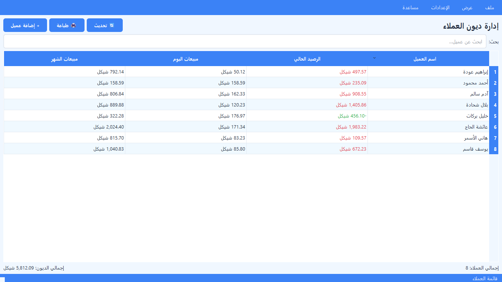
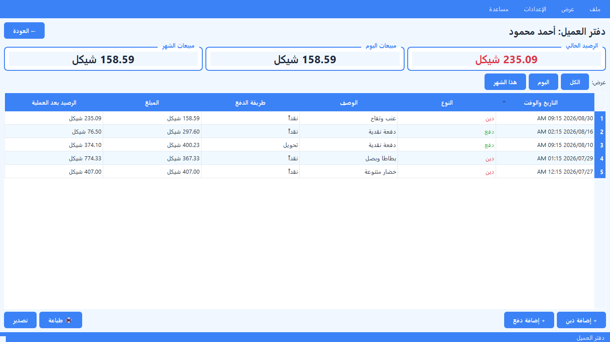
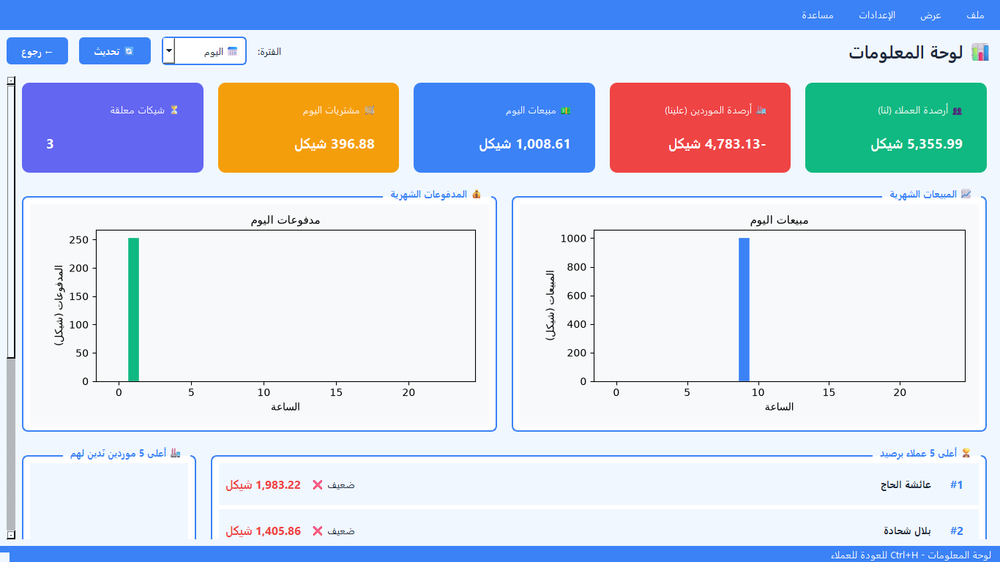
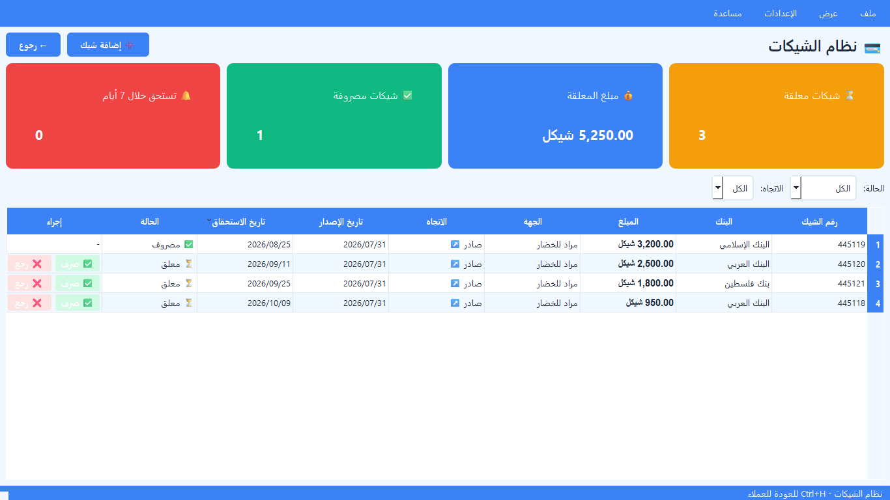
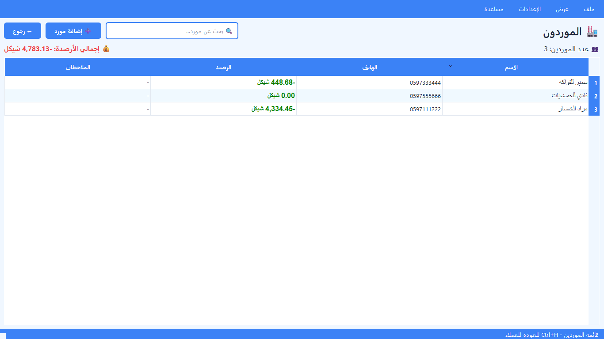
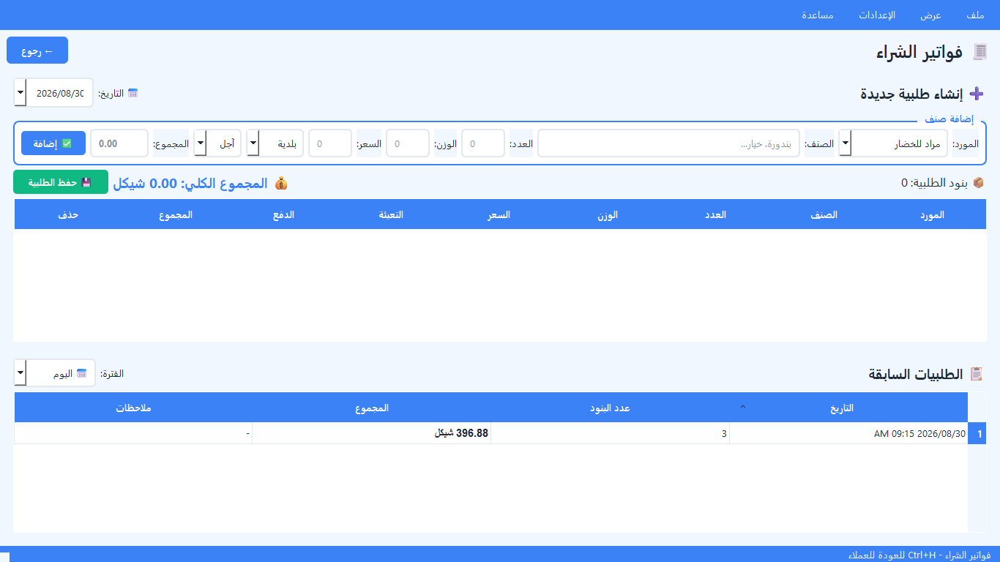

# إدارة ديون العملاء — Debt Manager

برنامج سطح مكتب لإدارة **ديون العملاء ومشتريات الموردين** في محلات الخضار
والفواكه. واجهة عربية كاملة من اليمين إلى اليسار، وتخزين محلّي بالكامل —
لا قاعدة بيانات، ولا خادم، ولا إنترنت.

[](https://github.com/AbuDergham/Debt-Manager/releases/latest)
[](https://github.com/AbuDergham/Debt-Manager/releases)

---

## التنزيل

**[⬇️ حمّل آخر إصدار](https://github.com/AbuDergham/Debt-Manager/releases/latest)**

ملف واحد محمول. ضعه في أي مجلد وشغّله — لا يحتاج تنصيباً ولا بايثون.
يُنشئ مجلد `data/` بجانبه في أول تشغيل.

بعد أول تشغيل يتحقّق البرنامج من التحديثات وحده، ويخبرك بهدوء إن توفّر
إصدار أحدث. **لا ينزّل شيئاً إلا بموافقتك.**

---

## الشاشات

### قائمة العملاء
أرصدة كل العملاء ومبيعات اليوم والشهر. اضغط رأس أي عمود لترتيب الجدول —
أبجدياً حسب الاسم، أو حسب الأعلى ديناً.



### دفتر العميل
كل حركات العميل برصيد تراكمي، مع فلترة زمنية وطباعة كشف حساب.



### لوحة المعلومات
أرصدة العملاء والموردين، ومبيعات الفترة، والشيكات المعلّقة، مع رسوم بيانية
تتغيّر حسب الفترة المختارة.



### الشيكات
مرتّبة بتاريخ الاستحقاق — الأقرب أولاً — مع تنبيه للمستحقّة خلال أسبوع.



### الموردون وفواتير الشراء





---

## المميزات

**العملاء**
إضافة وتعديل وحذف · دفتر لكل عميل برصيد تراكمي · حد ائتمان مع تحذير عند
التجاوز · ملاحظات · بحث فوري · بحث شامل في كل الحركات (`Ctrl+F`)

**الموردون**
دفتر لكل مورد · فواتير شراء ببنود (صنف، عدد، وزن، سعر، بلدية/بلاستيك،
آجل/نقدي) · دفعات · شيكات بثلاث حالات مع تنبيه الاستحقاق

**الطباعة والتصدير**
كشف أرصدة كل العملاء · كشف حساب عميل · **يتعرّف على نوع الطابعة تلقائياً**
(A4 أو حرارية ٥٨/٨٠مم) · حفظ PDF بعربية سليمة · تصدير Excel و CSV و JSON

**الأمان**
كتابة ذرّية لكل ملف — انقطاع الكهرباء لا يفسد الدفتر · نسخة احتياطية
تلقائية قبل كل حذف وقبل أي تحديث لصيغة البيانات · سجل تدقيق لكل تغيير ·
قفل بكلمة مرور

**التحديث التلقائي**
فحص عند كل فتحة · إشعار هادئ بلا مقاطعة · التنزيل بموافقتك فقط ·
يُستأنف إن انقطع الإنترنت · نسخة احتياطية قبل التثبيت · الإصدار السابق
يبقى للرجوع

**الاختصارات**
`Ctrl+H` العملاء · `Ctrl+M` الموردون · `Ctrl+P` فواتير الشراء ·
`Ctrl+K` الشيكات · `Ctrl+D` لوحة المعلومات · `Ctrl+F` بحث ·
`Ctrl+N` عميل جديد · `Escape` رجوع

---

## التشغيل من الكود

```bash
git clone https://github.com/AbuDergham/Debt-Manager.git
cd Debt-Manager
python -m venv .venv
.venv/Scripts/pip install -r requirements.txt
.venv/Scripts/python main.py
```

### الاختبارات

```bash
.venv/Scripts/pip install -r requirements-dev.txt
.venv/Scripts/python -m pytest
```

### بناء ملف تنفيذي

```bash
.venv/Scripts/python -m PyInstaller --clean Debt-Manager.spec
```

### نشر إصدار

```bash
.venv/Scripts/python tools/release.py
```

يتحقّق من نظافة المستودع، يشغّل الاختبارات، يبني الملف التنفيذي، يحسب
بصمته، وينشره على GitHub. **يتوقّف عند أي اختبار فاشل.**

---

## البنية

```
core/       الطبقة الأساسية — لا تستورد الواجهة أبداً
  models      نماذج البيانات التسعة
  storage     كل عمليات القرص + CRUD
  migrations  ترحيل صيغة البيانات
  summaries   حساب الأرصدة
  reports     بناء تقارير HTML (بلا Qt)
  updater     التحديث عبر GitHub
  audit       سجل التدقيق
  backup      النسخ الاحتياطي

ui/         الطبقة الرسومية — تستهلك core فقط
data/       بيانات المحل (تُنشأ تلقائياً، لا تُرفع)
tests/      268 اختباراً
```

القواعد الحاكمة والمصائد المعروفة موثّقة في [`CLAUDE.md`](CLAUDE.md)،
وقرارات التصميم ومبرراتها في [`docs/superpowers/specs/`](docs/superpowers/specs/).

---

## متطلبات التشغيل

ويندوز · بايثون 3.10+ للتشغيل من الكود (النسخة التنفيذية لا تحتاجه)

المكتبات: PySide6 · matplotlib · openpyxl

---

## الترخيص والدعم

المطوّر: AbuDergham
للمشاكل والاقتراحات: [صفحة Issues](https://github.com/AbuDergham/Debt-Manager/issues)
